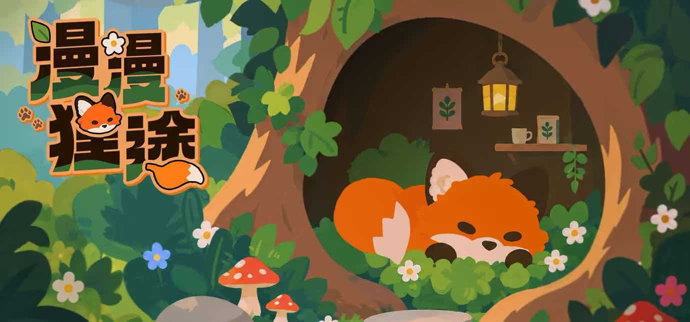

<h1>漫漫狸途</h1>

<strong>带上一点水和种子，陪小狐狸走过一段会生长的旅程。</strong>

一款关于旅行、播种与生态变化的轻松游戏。

## 游戏介绍

在桌面的一角，与小狐狸开启一场悄然生长的旅程吧！你的每一次选择，都会引发意想不到的连锁变化，让整片土地焕然一新。

这是一款以“涌现”为核心的休闲桌面放置游戏。玩家沿途收集并投放有限的种子与水源，晕染脚下的方寸自然。在这里，自然不会完全按照你的计划生长。同样的种子落在不同的环境中，可能萌芽、繁盛，也可能悄然消失。一滴水或许唤醒荒芜，也可能淹没花草。每一次干预都有回应，却没有固定的答案。

当旅程结束，回望这片由你与自然共同塑造的世界，那些不经意的选择，早已生长成独一无二的风景。

### 旅途中可以做什么

| 🌱 播种与照料 | 💧 观察生态 | 🦊 收藏旅程 |
| :--- | :--- | :--- |
| 在木牌处预设水和种子的投放，陪植物慢慢生长。 | 观察降雨、水分与温度如何影响沿途的土地。 | 穿越不同地貌，在终点回看完整的旅途长卷。 |

## 游戏下载

- [GitHub Releases](https://github.com/congyuxiaoyoudao/Foxtrail/releases)
- [TapTap 商店](https://tap.cn/lWiFIzuj2)

## 团队成员

| 成员 | 职责 |
| :--- | :--- |
| 识鸢 | 队长、PM、程序 |
| illu | 主策、程序 |
| 杏莹 | 策划 |
| 杏子鸡尾酒 | 策划 |
| 一柠 | 主美 |
| 林林林 | 美术 |
| 地味妹 | 美术 |
| Kevin | 主程 |
| gwynaire | 程序 |
| 予桐 | 音效 |

---

<em>愿每一段路，都有新的风景。</em>

